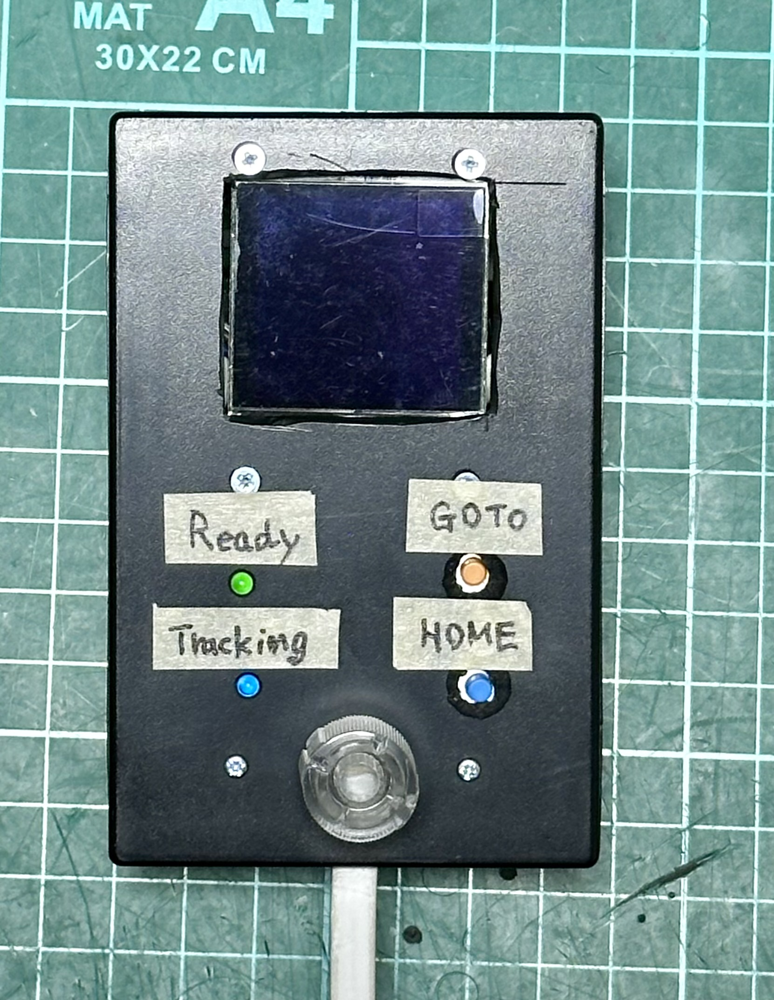
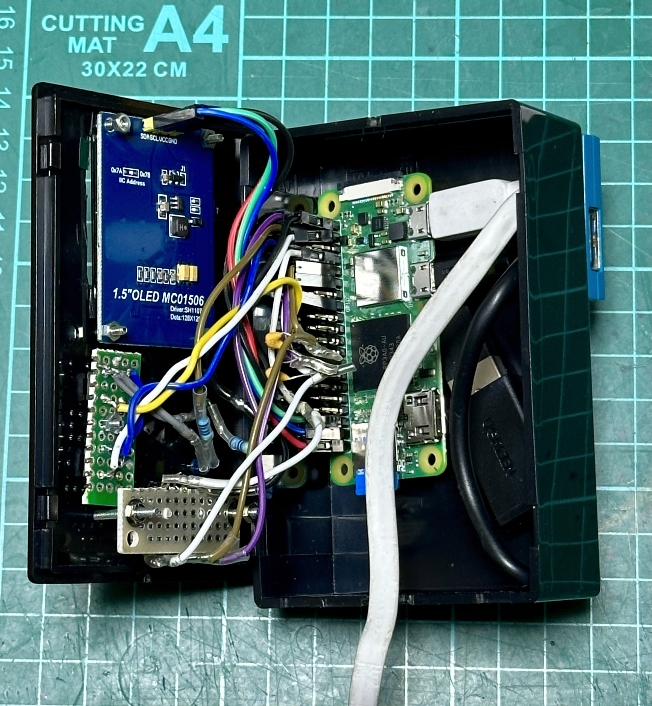
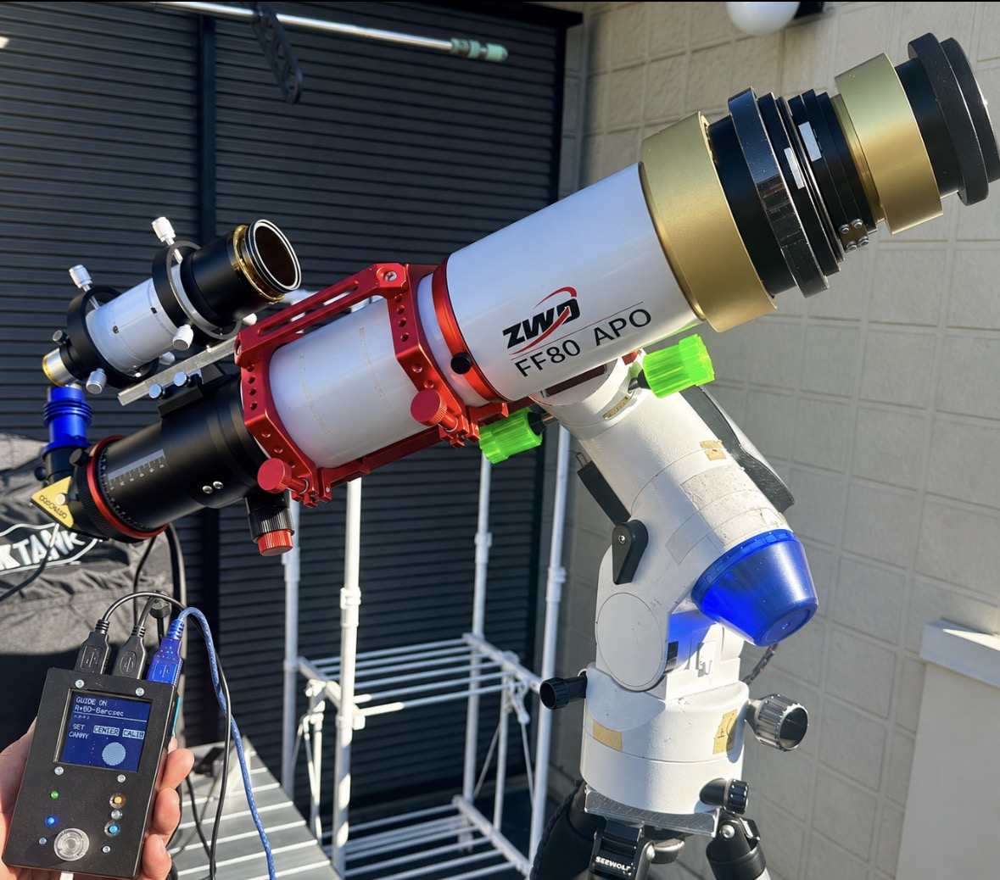
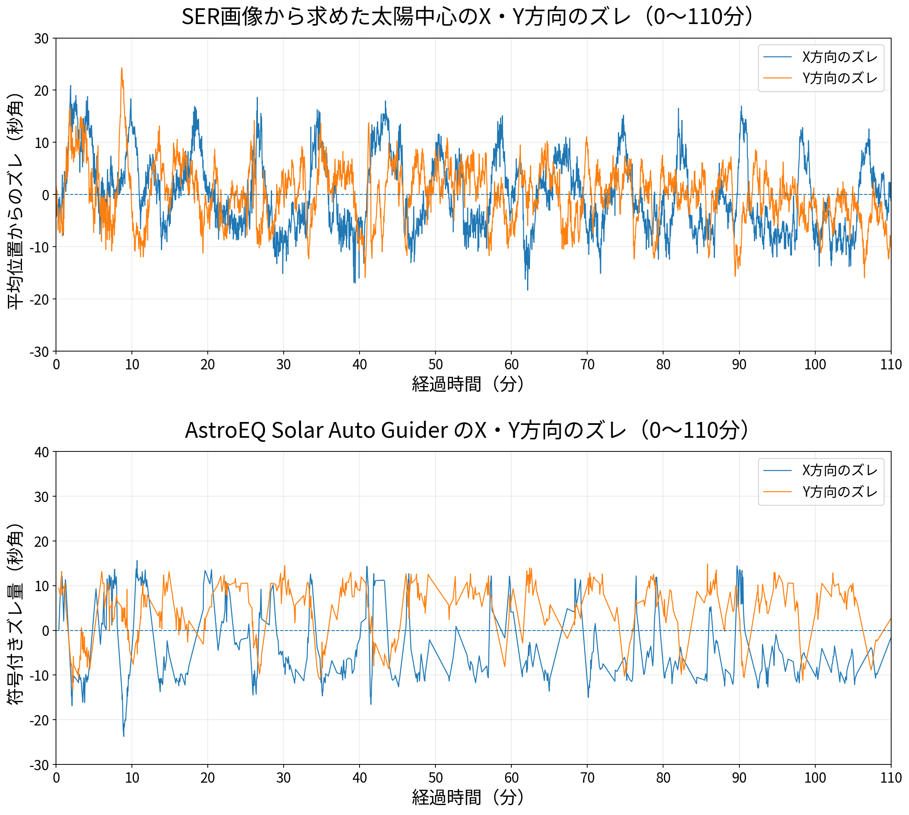

# AstroEQ Solar Auto Guider

[日本語](README_JA.md)

**Standalone Solar Autoguider for AstroEQ**

AstroEQ Solar Auto Guider is a standalone solar GoTo and autoguiding controller that runs on a Raspberry Pi Zero 2W without a PC. It obtains position and UTC from GPS and connects directly to an AstroEQ equatorial mount controller over USB serial. It detects the center of the Sun in images from a USB V4L2 guide camera and controls RA and DEC using guide rate × pulse duration.

The public stable release includes image-based RA and DEC calibration and uses up to 24 pulses during calibration to take up mechanical play in DEC. The separately developed PHD2-style backlash measurement and automatic compensation feature is excluded from the 16 stable source files.

This is an independent, unofficial project. AstroEQ and PHD2/OpenPHDGuiding are unaffiliated with the project and have neither endorsed nor supported it.

## 1. Controller Exterior



A single enclosure houses a 128×128 OLED, status LEDs, the GoTo and HOME switches, and a rotary encoder. The Raspberry Pi starts the controller software at power-on. The system enters the Ready state after the required GPS, AstroEQ, camera, and solar altitude checks pass.

| Display or control | Function |
|---|---|
| SH1107 OLED | Displays startup status, manual controls, guide menus, calibration status, settings, and guide camera images |
| Ready LED (green) | Lights when startup checks pass and the controller is ready to operate |
| GoTo switch | Starts Solar GoTo from standby |
| Tracking LED (blue) | Lights when the mount starts tracking |
| HOME switch | Stops tracking and returns to the position recorded immediately before GoTo |
| Rotary encoder | Selects manual moves, guide functions, calibration, and settings. Press the shaft switch to confirm. |

The saved HOME position is a motor counter reference. There is no sensor that detects an absolute home position.

## 2. Inside the Enclosure



The enclosure contains the Raspberry Pi Zero 2W, SH1107 OLED module, front-panel controls, status LEDs, and wiring. The GPS receiver, AstroEQ, and USB V4L2 camera connect through the Raspberry Pi's USB host interface. The stable software uses the Pi GPIO pins directly. The controller contains no AstroEQ firmware or PHD2 components.

The photograph documents the tested unit. It provides a partial view of the wiring. Component ratings that the stable source cannot establish are left unspecified.

## 3. Hardware Used

| Item | Tested configuration |
|---|---|
| Computer | Raspberry Pi Zero 2W |
| OS | Debian 13.7 (trixie), ARM64 |
| Display | SH1107 OLED, 128×128, I2C address `0x3C` |
| Controls | GoTo switch, HOME switch, and rotary encoder with a push switch |
| Status indicators | Ready LED and Tracking LED |
| GPS | u-blox USB GPS、VID:PID `1546:01A7` |
| Mount controller | AstroEQ connected directly over USB serial |
| Guide camera | USB V4L2 camera |
| Main telescope | Telescope used for solar H-alpha imaging in the field test |
| Guide scope | Solar guide scope fitted to the same equatorial mount |

The source code recognizes the following AstroEQ USB IDs.

| AstroEQ USB interface | VID:PID |
|---|---|
| Controller with CH340 | `1A86:7523` |
| Controller with Arduino Mega | `2341:0042` |

These are the device detection paths used on the tested hardware. Compatibility with other controllers that share the same USB interface requires separate verification.

### 3.1 Auxiliary Parts, Power, and USB Connections

| Auxiliary part | Purpose and checks |
|---|---|
| microSD card | Boot media for the Pi. Verify the capacity and model on the actual unit. |
| Pi power supply and micro-USB power cable | Used for board power. Verify the actual power path and the supply's output voltage and current ratings. |
| USB hub and micro-USB OTG adapter or host cable | Example setup for connecting 3 USB devices. Verify the hub model, how it is powered, and the actual connection hardware. |
| LED current-limiting resistors | Use 1 per LED when driving the LEDs directly from GPIO. Verify the resistance values on the actual unit. |
| 10 nF capacitors | Install 1 from each encoder input (A and B) to GND, for a total of 2. This wiring is documented in the stable source. |
| Enclosure, mounting hardware, and wiring | Used to secure and wire the Pi, OLED, LEDs, and controls. Verify the part models on the actual unit. |

The Raspberry Pi Zero 2W has a micro-USB power input labeled `PWR IN` and a micro-USB data port that can act as a USB host. In the example host setup, connect the data port to the hub's upstream port through an OTG adapter or host cable. Connect the AstroEQ USB serial interface, USB GPS receiver, and USB guide camera to the downstream ports. See the [official Raspberry Pi documentation](https://www.raspberrypi.com/documentation/computers/zero.html) for board specifications. Check the connected devices' specifications and current draw when deciding how to power the Pi and USB peripherals. Connect the mount drive supply according to the AstroEQ and mount specifications.

## 4. Raspberry Pi Zero GPIO Connections

This project uses **BCM numbers** for GPIOs. Refer to the physical pin column when wiring the header.

| Part | BCM GPIO | Physical pin | Connection or function |
|---|---:|---:|---|
| Ready LED | GPIO21 | 40 | Ready status output |
| Tracking LED | GPIO20 | 38 | Tracking status output |
| GoTo switch | GPIO22 | 15 | Switch input |
| HOME switch | GPIO26 | 37 | Switch input |
| Encoder A | GPIO5 | 29 | Linux rotary-encoder overlay input |
| Encoder B | GPIO6 | 31 | Linux rotary-encoder overlay input |
| Encoder push switch | GPIO13 | 33 | Selection and long-press input |
| OLED SDA | GPIO2 | 3 | I2C data |
| OLED SCL | GPIO3 | 5 | I2C clock |

Use 3.3 V-compatible GPIO wiring. Disconnect power before wiring, use suitable current-limiting resistors for the LEDs, and never apply 5 V directly to a GPIO pin.

### 4.1 Additional Wiring Details

| Part | Wiring and checks |
|---|---|
| GoTo and HOME switches | Wire GoTo between BCM22 (physical pin 15) and GND, and HOME between BCM26 (physical pin 37) and GND. The inputs use internal pull-ups and are pulled to GND when pressed. |
| Encoder A, B, and COM | The stable source specifies wiring EC12 terminal A to BCM5 (physical pin 29), B to BCM6 (physical pin 31), and COM to GND. Connect 1 capacitor of 10 nF between A and GND and another between B and GND. |
| Encoder push switch | Wire the contact between BCM13 (physical pin 33) and GND. The input uses an internal pull-up. |
| Ready and Tracking LEDs | Ready uses BCM21 (physical pin 40), and Tracking uses BCM20 (physical pin 38). Each output goes HIGH to light its LED. For direct GPIO drive, wire the current-limiting resistor and LED in series from each output, with the cathode toward GND. Verify the actual wiring and resistance values. |
| SH1107 OLED | SDA uses BCM2 (physical pin 3), and SCL uses BCM3 (physical pin 5). The display uses address `0x3C` on I2C bus 1. Connect the OLED and Pi grounds together. Verify the OLED's VCC terminal, supported supply voltage, actual power source, and the voltage rail used by the SDA and SCL pull-ups. |
| Power and ground pins | Physical pins 1 and 17 on the Pi header provide 3.3 V. Physical pin 6 is one of the GND pins. These pins have no BCM GPIO numbers. Check the module specifications and actual wiring before powering the OLED. |

Verify the OLED board, camera, and switch models, the encoder variant and pinout, and which GND pins the unit uses.

## 5. Raspberry Pi Zero Setup

### 5.1 Tested Software Environment

| Component | Version on the tested stable unit |
|---|---|
| Debian | 13.7 (trixie), ARM64 |
| Linux kernel | `6.18.50+rpt-rpi-v8` |
| Python | 3.13.5 |
| OpenCV | 4.10.0 |
| NumPy | 2.2.4 |
| Pillow | 11.1.0 |
| pySerial | 3.5 |
| GPIO Zero | 2.0.1 |
| python-evdev | 1.9.1 |
| lgpio | 0.2.2.0 |
| luma.oled | 3.16.0 |
| luma.core | 2.4.2 |
| gpsd / Python GPS interface | 3.25 |
| v4l-utils | 1.30.1 |

The tested unit uses an apt-based system-wide installation without a Python virtual environment. Package versions may change as the Debian repositories are updated.

### 5.2 I2C, USB Host, and Rotary Encoder

Add the following settings to `/boot/firmware/config.txt`.

```ini
dtparam=i2c_arm=on
dtoverlay=dwc2,dr_mode=host
dtoverlay=rotary-encoder,pin_a=5,pin_b=6,relative_axis=1,steps-per-period=2
```

Reboot after changing the boot configuration. The rotary-encoder overlay creates a Linux input device that the program reads through `evdev`.

### 5.3 System Packages

Install the available Debian packages in a terminal on the Raspberry Pi. Use apt package names for apt and PyPI distribution names for pip.

```bash
sudo apt update
sudo apt install python3-opencv python3-numpy python3-pil python3-serial \
  python3-gpiozero python3-evdev python3-lgpio \
  python3-luma.oled python3-luma.core python3-gps \
  gpsd gpsd-clients v4l-utils i2c-tools
```

For Debian 13 (trixie) on ARM64, apt provides `python3-luma.oled` at `3.10.0-1` and `python3-luma.core` at `2.4.2-1`. The tested luma.oled 3.16.0 requires a separate installation. The apt version of luma.core matches the tested 2.4.2 release.

If you need the exact tested versions, run the following as the service user to install the pinned versions into that user's Python environment. Debian 13 marks its Python environment as externally managed. The `--break-system-packages` flag overrides this protection. Even with `--user`, the installed versions can take precedence over the apt versions and affect other Python programs run by the same user. Use this option only if you understand the effects.

```bash
sudo apt install python3-pip
python3 -m pip install --user --break-system-packages 'luma.core==2.4.2' 'luma.oled==3.16.0'
python3 -c "import importlib.metadata as m; print(m.version('luma.core'), m.version('luma.oled'))"
```

To compare your setup with the tested unit, check the OS and apt package versions and the paths from which Python loads the modules. Run the checks as the service's `User`, including after installing pinned versions.

```bash
cat /etc/os-release /etc/debian_version
dpkg --print-architecture
uname -r
/usr/bin/python3 --version
dpkg-query -W python3-opencv python3-numpy python3-pil python3-serial \
  python3-gpiozero python3-evdev python3-lgpio \
  python3-luma.oled python3-luma.core python3-gps gpsd v4l-utils
apt-cache policy python3-luma.oled python3-luma.core

/usr/bin/python3 - <<'PY'
from importlib import import_module
from importlib.metadata import PackageNotFoundError, version

for name, dist in (
    ("cv2", "opencv-python"), ("numpy", "numpy"), ("PIL", "Pillow"),
    ("serial", "pyserial"), ("gpiozero", "gpiozero"), ("evdev", "evdev"),
    ("lgpio", "lgpio"), ("gps", "gps"), ("luma.core", "luma.core"),
    ("luma.oled.device", "luma.oled"),
):
    mod = import_module(name)
    value = getattr(mod, "__version__", None)
    if value is None:
        try:
            value = version(dist)
        except PackageNotFoundError:
            value = "dpkg-queryの結果を参照"
    print(f"{name}: {value}  {getattr(mod, '__file__', '')}")

from luma.oled.device import sh1107
PY
```

To reproduce the tested combination, verify that `luma.oled` is `3.16.0`, `luma.core` is `2.4.2`, and `sh1107` imports successfully. If a different version appears, check the user, Python path, and module path shown.

The user running the program needs access to its devices. Common groups are `dialout`, `video`, `input`, `gpio`, and `i2c`. Check device group ownership on the actual system before adding the user to any group.

```bash
sudo usermod -aG dialout,video,input,gpio,i2c USERNAME
```

After changing group memberships, log out and back in or reboot. Before enabling automatic startup, check the OLED at address `0x3C`, V4L2 camera, GPS fix through gpsd, and AstroEQ serial device individually.

### 5.4 Checking Connected Devices

Apply the settings in Section 5.2, reboot, and install the dependencies in Section 5.3 before running these checks. Run them as the service user before starting the integrated program. If `lsusb` is unavailable, install `usbutils` with apt.

**OLED**

```bash
i2cdetect -l
i2cdetect -y 1
```

Verify that I2C bus 1 exists and that the scan shows `3c`. An entry of `UU` means a kernel driver is using the address. If `3c` is missing, check the bus number, OLED power, GND, SDA, SCL, and address. If you get a permission error, check the group that owns `/dev/i2c-1` and the user running the check.

**Rotary encoder**

```bash
/usr/bin/python3 - <<'PY'
from evdev import InputDevice, list_devices

for path in list_devices():
    device = InputDevice(path)
    try:
        print(path, device.name)
    finally:
        device.close()
PY
```

Verify that the service user can see exactly 1 device named `rotary@5`. If it is missing, check the overlay in Section 5.2 and the permissions on `/dev/input/event*`. The push switch uses the separate BCM13 input.

**GPS and AstroEQ**

```bash
lsusb
systemctl status --no-pager gpsd.socket
gpspipe -w -n 20
/usr/bin/python3 -m serial.tools.list_ports -v
```

Check `lsusb` for GPS ID `1546:01a7` and the AstroEQ VID:PID listed in Chapter 3. In `gpspipe`, confirm that `DEVICES` lists the receiver path and that `TPV` provides a valid fix with UTC, latitude, and longitude. If the receiver appears in the USB listing but is missing from `DEVICES`, check its registration with `gpsd` and inspect `journalctl -u gpsd.service -b --no-pager`.

Match the AstroEQ VID:PID to its device name in the serial port list. Verify that the user has read and write access and that no other process is using the port. Check the AstroEQ response during integrated startup as described in Chapter 6.

**USB guide camera**

```bash
v4l2-ctl --list-devices
v4l2-ctl -d /dev/video0 --all
v4l2-ctl -d /dev/video0 --list-formats-ext
```

The default device for integrated startup is `/dev/video0`. Verify that this node captures video from the intended camera and check the formats it supports. The stable release requests `YUYV`, 800×600, and 15 fps. The actual format depends on the device and driver. Frame capture is checked during camera initialization after tracking starts.

## 6. Installing the Python Scripts

Place the repository in the installation directory of your choice. The example uses `/home/pi/AstroEQ-Solar-Auto-Guider`. Substitute your actual user name and path.

Once the official public URL is available, replace the placeholder in the following command to clone the repository.

```bash
git clone https://github.com/jun1wata/AstroEQ-Solar-Auto-Guider.git /home/pi/AstroEQ-Solar-Auto-Guider
```

The `src` directory contains the 16 unchanged stable Python source files.

| Role | Files |
|---|---|
| Integrated launcher | `run_solar_goto_with_oled.py` |
| Solar position, GoTo, and tracking | `astroeq_sun_position.py`, `astroeq_sun_tracking_generic_ch340.py`, `astroeq_sun_tracking_guided.py`, `astroeq_tracking_relative_goto_1arcsec.py` |
| Mount and guiding interfaces | `astroeq_remote_mount.py`, `astroeq_guide_socket.py`, `astroeq_pulse_autoguide.py`, `astroeq_guide_quality.py` |
| Camera calibration | `astroeq_camera_calibration_halfarcsec.py` |
| Startup and OLED controls | `astroeq_startup_oled.py`, `oled_ui_dev.py`, `oled_ui_camera_calibration_1arcsec_dev.py`, `solar_center_oled_modes_right.py`, `ssd1315_encoder.py`, `ssd1315_oled_modes_right.py` |

Run the integrated launcher from the `src` directory.

```bash
cd /home/pi/AstroEQ-Solar-Auto-Guider/src
python3 -u run_solar_goto_with_oled.py \
  --ra-west-dir 0 \
  --dec-south-dir 1 \
  --enable-guide-after-cal \
  --cal-drift off
```

The direction arguments depend on the mount. Check both axes under safe conditions before unattended operation. Verify any values taken from another mount before using them.

Run the first manual launch as the account specified in the service's `User` field, before enabling the service in Chapter 7. If the service is already in use, follow the normal shutdown procedure in Chapter 11 and stop the service before launching manually. Keep the old `astroeq-sun.service` and any other AstroEQ control software stopped during the manual launch.

Start with the stationary checks in Chapter 11. Check the terminal log and the OLED indication for the reason the unit is waiting. To end the manual run, confirm that the mount has stopped, then press `Ctrl+C`.

## 7. Automatic Startup at Power-On

A single systemd service can launch the integrated program. The tested configuration uses `Restart=no` and has no `ExecStartPre` wait for USB devices.

```ini
[Unit]
Description=AstroEQ Solar Auto Guider
Wants=gpsd.socket
After=gpsd.socket systemd-udev-trigger.service

[Service]
Type=simple
User=pi
WorkingDirectory=/home/pi/AstroEQ-Solar-Auto-Guider/src
ExecStart=/usr/bin/python3 -u /home/pi/AstroEQ-Solar-Auto-Guider/src/run_solar_goto_with_oled.py --ra-west-dir 0 --dec-south-dir 1 --enable-guide-after-cal --cal-drift off
Restart=no

[Install]
WantedBy=multi-user.target
```

Substitute the actual user name and paths in `User`, `WorkingDirectory`, and `ExecStart`, then use the following command to place the service file.

```bash
sudoedit /etc/systemd/system/astroeq-solar-auto-guider.service
```

After saving the service definition, reload systemd, enable the service, and start it.

```bash
sudo systemctl daemon-reload
sudo systemctl enable --now astroeq-solar-auto-guider.service
```

Check the service status and logs for the current boot.

```bash
systemctl status --no-pager astroeq-solar-auto-guider.service
journalctl -u astroeq-solar-auto-guider.service -b --no-pager
```

An `active` service may still be waiting for a GPS fix or checking devices. Compare the OLED message with the logs above. If the service shows `failed` or exits immediately, look for the first error in the log.

- For `ModuleNotFoundError` or an OLED import error, follow Section 5.3 using the service's `User` and `/usr/bin/python3`.
- For path or permission errors, check `WorkingDirectory`, the script path in `ExecStart`, and the group ownership of the relevant devices.
- If GPS is still waiting, AstroEQ fails to respond, or the camera fails to appear or start, return to the checks in Section 5.4. Stop the mount safely before inspecting the USB connections.

With `Restart=no`, the service stays stopped after an abnormal exit. Resolve the cause and verify that the mount is stopped and safely positioned before starting it again. If you changed the unit definition, run `sudo systemctl daemon-reload` before starting.

```bash
sudo systemctl start astroeq-solar-auto-guider.service
```

## 8. Controlling the AstroEQ Equatorial Mount Controller

### 8.1 Direct USB Serial Control

The Raspberry Pi acts as the direct host for AstroEQ, with no PC or ASCOM, INDI, or PHD2 process required. The launcher detects supported USB IDs, opens the AstroEQ serial connection at 9600 bit/s, checks the response, and reads the motor parameters needed for GoTo and guiding.

The integrated configuration assigns a single owner to the physical serial connection. Camera calibration and autoguiding request mount moves through the local guiding interface, keeping the serial connection free of competing sessions.

### 8.2 Solar Center Detection

The software reads the guide camera as a V4L2 device. Image processing detects the solar limb and calculates the disc's center and radius. Calibration requires a stable center from a short sequence of frames. Missing or excessively scattered center detections cause calibration to fail before those detections can produce a mount move.

The OLED camera view offers the `CANNY`, `OTSU`, and `NONE` display modes. These modes affect the view and leave the meaning of the measured data from the 110-minute test unchanged.

### 8.3 RA and DEC Calibration

Calibration measures the image displacement produced by guide-rate pulses and builds a matrix that maps camera X and Y to mount RA and DEC. The documented service arguments use `--cal-drift off` to disable drift measurement and `--enable-guide-after-cal` to allow autoguiding after successful calibration.

The stable release calibrates in this order.

1. Obtain a stable solar center.
2. Send positive RA pulses until the target displacement is reached, within the implemented pulse limit.
3. Return RA using the same number of pulses in the opposite direction.
4. Take up mechanical play in DEC as described in the next section.
5. Measure using positive DEC pulses, then return using the same number of pulses in the opposite direction.
6. Validate the 2 calibration vectors and enable the guiding transform.

The stable algorithm uses 95% of the available guide rate and 1000 ms calibration pulses. The target displacement is 180 arcseconds, and the forward measurement is limited to 60 pulses on each axis. These values are the calibration settings in the stable source. They do not represent measured guiding performance.

### 8.4 DEC Mechanical Take-Up (Maximum 24 Pulses)

Before DEC calibration, the stable source sends DEC pulses in one direction and checks how far the solar center moves between consecutive images. It requires consistent detected motion and stops after a maximum of 24 pulses. Calibration fails if effective take-up cannot be confirmed within that limit.

This step takes up mechanical play before the DEC calibration vector is measured. It is part of the public stable calibration. Backlash measurement and automatic compensation on reversals during normal guiding are separate procedures.

### 8.5 RA and DEC Autoguiding by Rate × Time

After calibration, the software records a fixed guiding reference from stable solar-center samples. For each correction, it converts the X and Y center error using the calibration matrix, selects 1 axis per correction cycle, and drives that axis at the AstroEQ guide rate for the calculated duration. The configured per-axis maximum limits the pulse duration.

In the OLED's `SET` menu, you can change the maximum RA pulse, maximum DEC pulse, and guide period. The guiding UI uses its `--guide-gain` startup argument to calculate the pulse correction. The integrated launcher omits this argument, so the guiding UI uses its default of 0.2. Stable UI defaults include a maximum pulse duration of 500 ms and a guide period of 5 seconds. The software does not generate arbitrary corrections during a brief loss of solar-disc detection and stops guiding if the loss persists.

### 8.6 OLED and Rotary Encoder Operation

#### From Startup to Manual Control

When the integrated program starts after power-on, the OLED displays the title `AstroEQ`, `Solar`, `Auto`, `Guider`, followed by the status of the device checks. The messages are `WAITING FOR GPS` while waiting for GPS, `NO GPS FIX` when there is no fix, and `ASTROEQ` / `NO RESPONSE` if AstroEQ fails to respond.

When the green Ready LED lights, the OLED shows `PRESS GOTO` / `TO START`. Complete the checks in Chapter 11 before pressing GoTo. The display shows `PLEASE WAIT...` after accepting the request and `SLEWING` / `TO SUN...` when the mount starts slewing. When tracking starts, the blue Tracking LED lights. The OLED shows `STARTING` / `CAMERA...` during camera initialization, then switches to `MOUNT MANUAL`.

On the manual screen, short presses cycle through `RA HI` → `RA LOW` → `DEC HI` → `DEC LOW`. The initial selection is `RA HI`. Turn the knob to request relative motion on the selected axis. For 1 detent, the request is 180 arcseconds in HI and 20 arcseconds in LOW. `MOVING...` flashes at the top of the screen while a move is in progress.

The switch classifies the press at release. A press under 0.8 seconds counts as short, and a press of 0.8 seconds or more counts as long. Long-press on the manual screen to open the guiding screen, which shows `AUTO GUIDE: OFF` before calibration.

#### Guiding Screen and Calibration

Turn the knob to select an item and short-press to open it.

| Item | Operation |
|---|---|
| `SET` | Camera and guiding settings. The items are `CAM DEFAULT`, `CAM MANUAL`, `RA MAX PULSE`, `DEC MAX PULSE`, `GUIDE PERIOD`, and `EXIT`. Opening settings pauses guide corrections. A short press on `EXIT` returns to the guiding screen while keeping corrections paused. |
| `CENTER` | Inspect the solar image and detected center. Short-press to return to the guiding screen. |
| `CALIB` | Displays `CAL START` and `BACK`. Turn the knob to select `CAL START`, then short-press to start calibration on the mount. |

At the start, `MEASURING...` appears below `CALIBRATION`. During measurement, the OLED shows the axis, direction, and pulse count, such as `RA+ 1` or `DEC- 1`, followed by measured and target displacement in arcseconds. `PRESS: BACK` also appears while calibration is running. Calibration runs synchronously, so pressing the switch cannot interrupt it immediately. If there is a hazard, cut drive power as described in Chapter 11.

On success, the program returns to the guiding screen. With the documented startup arguments, it acquires a new reference from a stable solar center while displaying `CAL OK / GUIDE OFF`. The status changes to `GUIDE ON` when guiding is enabled.

On failure, the display shows `CAL FAILED` and `PRESS: BACK`, and guide corrections are disabled. Short-press to return to `CAL START` / `BACK`. Moves already performed are left in place. Check the solar image, mount position, cable clearance, and reason in the log before retrying. DEC take-up follows the procedure in Section 8.4, with a maximum of 24 pulses.

#### Pausing Guide Corrections and Returning HOME

Long-press on the guiding screen to switch to `MOUNT MANUAL` and pause automatic corrections. Solar tracking continues. If a valid calibration remains, returning to the guiding screen with the documented startup arguments acquires a fresh reference and resumes corrections.

To end tracking as well, confirm that the return path is safe, then press the dedicated HOME switch while tracking. The guiding UI closes and the mount returns to the position saved immediately before GoTo once the program confirms both axes have stopped. During the return, the OLED shows `GOTO` / `HOME` / `POSITION`. Afterward the program checks the standby conditions again and returns to `PRESS GOTO` / `TO START` once they pass.

### 8.7 Development Status of PHD2-Style DEC Backlash Compensation

The separately developed feature and the take-up procedure in the public stable release serve different purposes.

| Item | Status | Included in the 16 stable files in `src` |
|---|---|---|
| DEC take-up during calibration (maximum 24 pulses) | Stable implementation used by the public calibration routine | Included |
| PHD2-style backlash measurement and automatic compensation | Implemented in separate development code | Excluded |
| Simulated test of the development implementation | Tested in simulation | Test code and results excluded |
| Automatic compensation test on a physical mount | Unverified | Excluded |

This project makes no claims about hardware performance of the development feature, including RMS improvement, maximum error reduction, or compensation effectiveness. “PHD2-style” describes the design approach. This stable snapshot contains no PHD2 source code.

## 9. Solar GoTo Calculations

### 9.1 Solar Position

The program obtains UTC and the observing location from GPS and converts UTC to Julian date. It computes the Sun's right ascension and declination using the USNO approximation and obtains its hour angle from local sidereal time.

### 9.2 Angular Motion from Home

The mechanical coordinate transform from solar hour angle and declination to RA and DEC motion follows the AstroEQ Solar GoTo implementation tested on the mount. The configured RA-west and DEC-south direction arguments then determine the sign for each axis.

The expected home position has the telescope pointing toward the north celestial pole with the counterweight shaft vertically downward. Image calibration cannot substitute for this mechanical starting position.

### 9.3 Conversion to Motor Counts

The program converts angles to movement counts using the RA and DEC counts per revolution read from AstroEQ. GoTo uses the controller's 24-bit counters and rejects any movement that the program's signed-difference calculation cannot represent unambiguously.

### 9.4 Home Position Management

Immediately before Solar GoTo, the program records the RA and DEC counters as the return reference. HOME stops tracking and requests a return to that reference. The return position can become invalid if missed steps, manual motion, or power loss breaks the correspondence between the counters and the actual mount position.

## 10. Coarse Polar Alignment Using Solar GoTo

Solar GoTo can help with coarse polar alignment. Start from the specified home position, run Solar GoTo, and use the mount's altitude and azimuth adjustments to center the safely filtered solar image.

This method provides coarse alignment only. A single solar position cannot independently eliminate both altitude and azimuth errors. Image drift correction by the autoguider does not establish the accuracy of the polar alignment.

## 11. Safety

Use only equipment designed for solar observation. Never view the Sun through an unfiltered optical system, finder, or camera. Use a suitable solar filter or dedicated solar telescope. Inspect the filters, mount, cables, and stops before applying power.

The software provides no independent collision detection. Before the first GoTo, check the home position, motor directions, cable clearance, travel range, balance, and that the mount has stopped. Keep clear of moving parts.

GoTo, HOME, and the encoder switch send inputs to the software. Reliable emergency stopping requires an independent means of stopping the mount safely, such as immediately cutting motor power. A software or serial communications failure can prevent a stop command from reaching AstroEQ.

### 11.1 Optical and Mechanical Checks

Inspect the main telescope, guide scope, and finder separately. For optics that use a front-aperture filter, securely fit a solar filter specified by the manufacturer for that purpose. Check for scratches, tears, loose edges, and anything that could cause it to come off. Use dedicated solar telescopes with the optical configuration and procedures specified by the manufacturer. Remove any unused finder or securely block its front aperture.

Before starting GoTo, set the mount to the mechanical home position in Section 9.2. Point the telescope tube toward the north celestial pole, with the counterweight shaft vertically downward. Verify that the tripod, tube, and counterweights are secure and that the mount is balanced. Route the power, USB, and camera cables with enough slack to avoid wrapping around the axes, pinching, or tension throughout GoTo, tracking, and HOME travel.

### 11.2 First-Test Sequence

1. Perform the first stationary checks and drive-direction test with the main telescope, guide scope, and finder protected from hazardous sunlight. Check the devices in Section 5.4 with the mount stationary. On first startup, check the OLED and logs without pressing GoTo. Conditions such as solar altitude can keep the unit in standby.
2. Perform the initial drive-direction check while pointing safely away from the Sun. Follow the mount manufacturer's test procedure. Away from the travel limits, move each axis briefly, one at a time, and verify the RA-west and DEC-south directions. If you are unsure about direction or stopping, check the settings and wiring before proceeding to Solar GoTo.
3. Configure the optics for solar observation and return the mount to mechanical home. Before GoTo, verify that the mount is stopped and check the travel path, cable clearance, and independent means of cutting drive power. Monitor the motion and keep the power cutoff within immediate reach when starting GoTo.
4. Before calibration, inspect the solar disc and detected center in `CENTER`. Make sure the disc is fully in frame, the center is stable, and there is enough mechanical clearance and room in the image for test moves on both RA and DEC. Then select `CAL START`. Continue to monitor mount motion and the cables after guide corrections start.

### 11.3 Fault Detection and Normal Shutdown

The stable release stops automatic corrections if solar-disc detection is lost for more than 3 seconds while guiding or if the image error exceeds the default 35 px threshold when it evaluates a correction. If the image error fails to improve after 3 consecutive corrections, the software logs a warning and continues correcting. Check the mount immediately if you hear unusual noises or notice incorrect movement, cables pulling tight, or the target leaving the field of view.

To stop only automatic corrections, switch from the guiding screen to the manual screen as described in Section 8.6. Solar tracking continues. For normal shutdown, check that the return path is safe and press HOME while tracking. HOME first stops tracking. It moves toward the recorded position only after confirming that the mount has stopped. Verify that the return is complete and the mount is physically stationary.

If manual movement of an axis, missed steps, or power loss makes the saved position unreliable, avoid automatic HOME and restore the mount position using the equipment's procedure.

### 11.4 Cutting Drive Power in an Emergency

Before operation, identify an external power switch or independent cutoff that can immediately remove power from the motors in accordance with the AstroEQ and mount specifications. If there is a risk of collision or entanglement, unexpected motion, or uncertainty that the mount has stopped, use the designated cutoff without waiting for software operations to finish.

Unplugging USB, switching off the Pi, pressing `Ctrl+C`, or stopping the service does not verify that drive power is off or that the mount is stationary. If a communications failure or abnormal exit prevents you from confirming that the stop command reached the mount, cut drive power and verify that motion has stopped. Resolve the cause and check the cables and mount position before restoring power and restarting from mechanical home.

## 12. Current Limitations and Future Work

### 12.1 Scope of the Public Stable Release

| Feature | Status in the public stable release |
|---|---|
| GPS position and UTC acquisition | Included |
| Solar GoTo and direct AstroEQ control | Included |
| Solar center detection | Included |
| Image-based RA and DEC calibration | Included |
| DEC take-up during calibration (maximum 24 pulses) | Included unchanged |
| RA and DEC autoguiding by rate × time | Included |
| OLED and rotary encoder controls | Included |
| PHD2-style backlash measurement and automatic compensation | Excluded from the stable snapshot |

This test alone does not establish compatibility with other GPS receivers, cameras, mount mechanisms, or AstroEQ configurations. The system has no absolute home sensor or automatic mechanical collision detection.

### 12.2 Field Test Setup

This photograph shows the test configuration. It includes the equatorial mount, the main telescope used for solar H-alpha imaging, the solar guide scope mounted above it, and the AstroEQ Solar Auto Guider at the lower left.



### 12.3 110-Minute Solar Autoguiding Field Test

This is a recorded field test of standalone solar autoguiding with a Raspberry Pi Zero 2W and AstroEQ Solar Auto Guider.

The main telescope and the solar guide scope were installed on the same equatorial mount. AstroEQ Solar Auto Guider calculated the solar center from guide-scope images and controlled RA and DEC using guide rate × pulse duration. Changes in the solar center position were also measured independently from SER images recorded by the main telescope.

The figure shows X and Y movement in arcseconds over approximately 110 minutes. The upper plot shows position offsets from the mean, calculated from the main telescope's SER images. The lower plot shows signed offsets calculated from the solar guide-scope images used by AstroEQ Solar Auto Guider. Blue represents X and orange represents Y in both plots. The stacked plots compare the 2 optical paths during the same autoguiding test.



The figure shows the measured data as originally plotted. It reports no uncalculated RMS values, maximum errors, correction rates, or comparisons with unguided performance. The test covered the stable rate × time autoguiding implementation. Backlash measurement and automatic compensation were outside its scope.

## 13. License

The project's original Python source code is released under the MIT License with the existing copyright notice.

```text
Copyright (c) 2026 Junichi Watanabe
```

[LICENSE](LICENSE) contains the copyright and permission notices. See [THIRD_PARTY_NOTICES.md](THIRD_PARTY_NOTICES.md) for official third-party license sources and how each component is used.

### Third-Party Software and Reference Projects

| Project or library | License or notice | Relationship to this project |
|---|---|---|
| AstroEQ — Thomas Carpenter | AstroEQ `License.txt` grants MIT-style permission with additional project-specific terms requiring open-source publication of changes, prohibiting use for commercial gain, and requiring a link to the original project. | This project uses the serial communications protocol. AstroEQ firmware and official software are excluded. |
| PHD2 / OpenPHDGuiding | BSD 3-Clause | The separate development effort references the PHD2 approach. PHD2 source is excluded. |
| OpenCV | Apache License 2.0 | Runtime dependency |
| NumPy | BSD 3-Clause | Runtime dependency |
| Pillow | MIT-CMU (derived from PIL) | Runtime dependency |
| pySerial | BSD 3-Clause | Runtime dependency |
| GPIO Zero | BSD 3-Clause | Runtime dependency |
| python-evdev | BSD 3-Clause | Runtime dependency |
| luma.oled / luma.core | MIT | Runtime dependencies |
| lgpio | Unlicense | Runtime dependency |
| gpsd / Python GPS interface | gpsd project licensing. The main components are BSD-2-Clause. | Runtime and service dependency |

Each third-party component remains under its own license. The project's MIT License leaves those terms in effect. Review and comply with AstroEQ's additional terms when redistributing or modifying AstroEQ materials. This project is unofficial and unaffiliated with AstroEQ and PHD2/OpenPHDGuiding.

## 14. References

| Reference | URL |
|---|---|
| AstroEQ | https://github.com/TCWORLD/AstroEQ |
| AstroEQ License | https://github.com/TCWORLD/AstroEQ/blob/master/License.txt |
| PHD2 / OpenPHDGuiding | https://github.com/OpenPHDGuiding/phd2 |
| PHD2 License | https://github.com/OpenPHDGuiding/phd2/blob/master/LICENSE.txt |
| USNO: Computing Approximate Solar Coordinates | https://aa.usno.navy.mil/faq/sun_approx |
| USNO: Computing Approximate Sidereal Time | https://aa.usno.navy.mil/faq/GAST |
| Raspberry Pi Documentation | https://www.raspberrypi.com/documentation/ |
| OpenCV Documentation | https://docs.opencv.org/ |

---

This repository publishes the 16 stable Python source files from the Raspberry Pi Zero 2W unit with the calibration algorithm, AstroEQ communications method, and DEC take-up procedure of up to 24 pulses unchanged.
