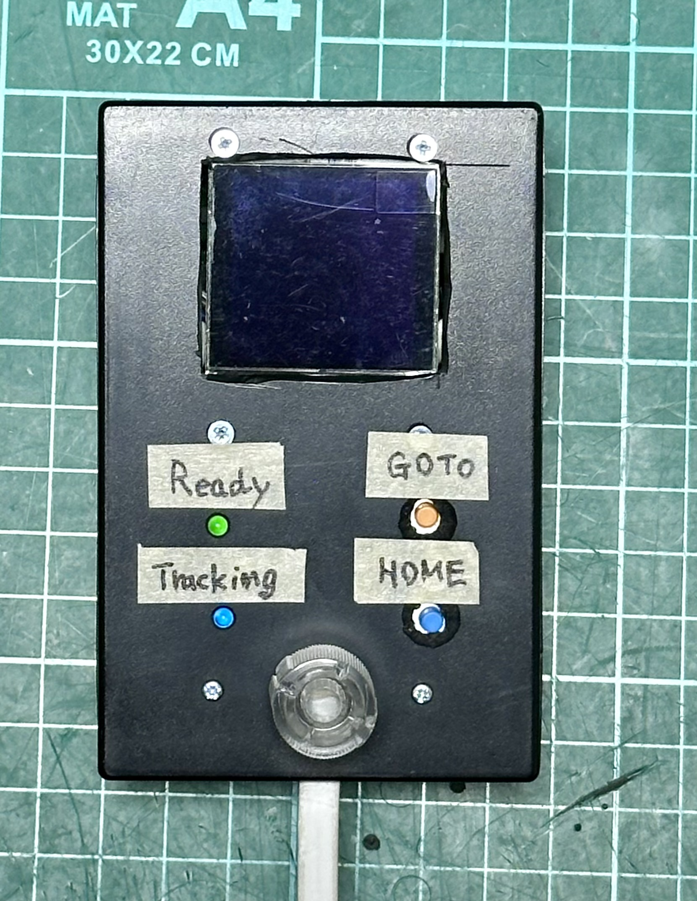
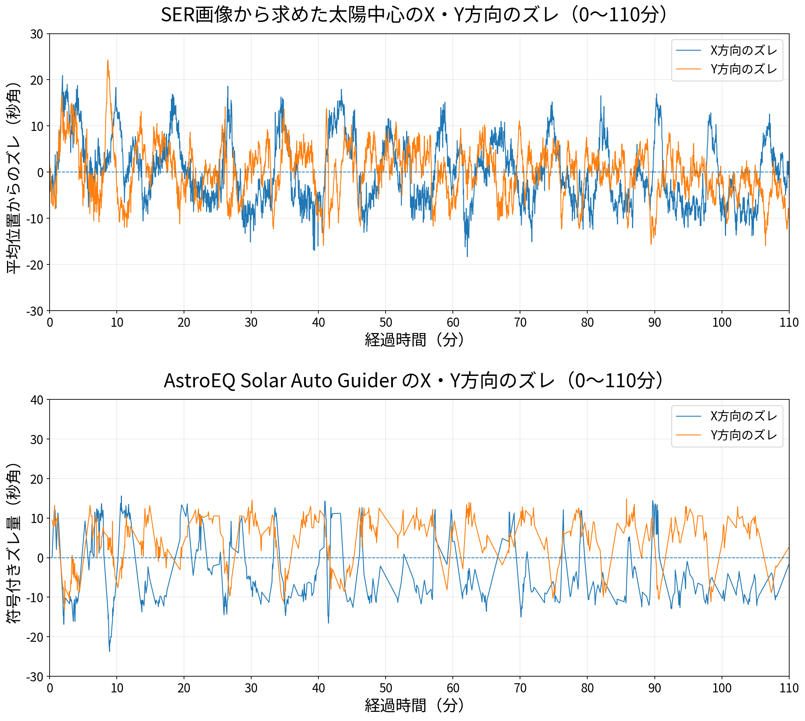

# AstroEQ Solar Auto Guider

[English](README.md)

**AstroEQ用スタンドアロン太陽オートガイダー**

AstroEQ Solar Auto Guiderは、Raspberry Pi Zero 2Wで動作するPC不要の太陽GoTo・オートガイドコントローラーです。GPSから位置とUTCを取得し、AstroEQ赤道儀コントローラーへUSBシリアルで直接接続します。USB V4L2ガイドカメラ画像から太陽中心を検出し、ガイド速度×パルス時間方式でRA・DECを制御します。

公開する安定版には、画像を使ったRA・DECキャリブレーションと、キャリブレーション時に最大24パルスを使用するDEC機械的遊び取り処理が含まれます。別系統で開発しているPHD2方式のバックラッシュ量測定・自動補償機能は、公開する16本の安定版ソースには含まれません。

本プロジェクトは独立した非公式開発であり、AstroEQおよびPHD2/OpenPHDGuidingとは提携しておらず、承認・支援を受けたものでもありません。

## 1. コントローラー外観



128×128 OLED、状態表示LED、GoTo・HOMEスイッチ、ロータリーエンコーダを1つのケースに組み込んでいます。電源投入時にRaspberry Piがコントローラーソフトウェアを起動し、GPS、AstroEQ、カメラ、太陽高度の必要な確認が完了した場合にReady状態になります。

| 表示・操作部 | 機能 |
|---|---|
| SH1107 OLED | 起動状態、手動操作、ガイドメニュー、キャリブレーション状態、設定、ガイドカメラ画像を表示 |
| Ready LED（緑） | 起動時の確認を通過し、操作可能な場合に点灯 |
| GoToスイッチ | 待機状態から太陽GoToを開始 |
| Tracking LED（青） | 赤道儀が追尾状態へ移行すると点灯 |
| HOMEスイッチ | 追尾を停止し、GoTo直前に記録した位置へ復帰 |
| ロータリーエンコーダ | 手動移動、ガイド機能、キャリブレーション、設定を選択し、軸スイッチで決定 |

記録されるHOME位置はモーターカウンター上の基準であり、絶対位置を検出するホームセンサーではありません。

## 2. ケース内部


ケース内にはRaspberry Pi Zero 2W、SH1107 OLEDモジュール、前面操作部、状態表示LEDと配線を収めています。GPS、AstroEQ、USB V4L2カメラはRaspberry PiのUSBホスト経路へ接続します。安定版ソフトウェアはRaspberry PiのGPIO端子を直接使用し、AstroEQファームウェアやPHD2の構成要素をコントローラー内へ組み込むものではありません。

この写真は実機の記録として掲載しています。完全な配線図ではなく、安定版ソースから確認できない部品定格は推測していません。

## 3. 使用したハードウェア

| 機器 | 実機構成 |
|---|---|
| コンピューター | Raspberry Pi Zero 2W |
| OS | Debian 13.7（trixie）、ARM64 |
| 表示器 | SH1107 OLED、128×128、I2Cアドレス`0x3C` |
| 操作入力 | GoToスイッチ、HOMEスイッチ、押し込みスイッチ付きロータリーエンコーダ |
| 状態表示 | Ready LED、Tracking LED |
| GPS | u-blox USB GPS、VID:PID `1546:01A7` |
| 赤道儀コントローラー | USBシリアルで直接接続するAstroEQ |
| ガイドカメラ | USB V4L2カメラ |
| 主望遠鏡 | 実機試験で太陽Hα撮影に使用した望遠鏡 |
| ガイド鏡 | 同じ赤道儀へ搭載した太陽ガイド鏡 |

ソースコードは、次のAstroEQ USB識別番号を認識します。

| AstroEQ USBインターフェース | VID:PID |
|---|---|
| CH340搭載コントローラー | `1A86:7523` |
| Arduino Mega搭載コントローラー | `2341:0042` |

これらは実機で使用する検出経路を示すものであり、同じUSBインターフェースを持つすべてのコントローラーとの互換性を保証するものではありません。

### 3.1 補助部品と電源・USB接続

| 補助部品 | 用途・確認事項 |
|---|---|
| microSDカード | Piの起動メディア。容量・型番は要実機確認。 |
| Pi用電源・micro-USB電源ケーブル | 基板の電源入力に使用。実機の給電経路、電源の出力電圧・電流定格は要実機確認。 |
| USBハブ・micro-USB OTGアダプターまたはホスト用ケーブル | 3台のUSB機器を接続する構成例。ハブの型番・給電方式、実際の接続部品は要実機確認。 |
| LED用電流制限抵抗 | LEDをGPIOから直接駆動する場合は各LEDに1本。実機の抵抗値は要実機確認。 |
| 10 nFコンデンサー | エンコーダのA・B各入力からGNDへ1個ずつ、計2個。安定版ソースに記載されている配線です。 |
| ケース・固定部品・配線材 | Pi、OLED、LED、操作部品を固定・配線。部品型番は要実機確認。 |

Raspberry Pi Zero 2Wには、給電用のmicro-USB端子 `PWR IN` とUSBホスト用に使えるmicro-USBデータ端子があります。ホスト接続の構成例では、データ端子からOTGアダプターまたはホスト用ケーブルでハブの上流側につなぎ、下流側にAstroEQのUSBシリアル、USB GPS、USBガイドカメラを接続します。基板仕様は[Raspberry Pi公式資料](https://www.raspberrypi.com/documentation/computers/zero.html)を参照してください。PiとUSB機器の給電は、使用する機器の仕様と消費電流を確認して決めてください。赤道儀の駆動電源はAstroEQと赤道儀の仕様に従って接続します。

## 4. Raspberry Pi ZeroのGPIO接続

本プロジェクトのGPIO番号は**BCM番号**です。物理ピン番号とは区別してください。

| 部品 | BCM GPIO | 物理ピン番号 | 接続・役割 |
|---|---:|---:|---|
| Ready LED | GPIO21 | 40 | Ready状態出力 |
| Tracking LED | GPIO20 | 38 | 追尾状態出力 |
| GoToスイッチ | GPIO22 | 15 | スイッチ入力 |
| HOMEスイッチ | GPIO26 | 37 | スイッチ入力 |
| ロータリーエンコーダA | GPIO5 | 29 | Linux rotary-encoder overlay入力 |
| ロータリーエンコーダB | GPIO6 | 31 | Linux rotary-encoder overlay入力 |
| ロータリー押し込みスイッチ | GPIO13 | 33 | 選択・長押し入力 |
| OLED SDA | GPIO2 | 3 | I2Cデータ |
| OLED SCL | GPIO3 | 5 | I2Cクロック |

GPIO配線は3.3V系で行います。配線作業前に電源を切り、LEDには適切な電流制限抵抗を使用し、GPIO端子へ5Vを直接接続しないでください。

### 4.1 接続の補足

| 部位 | 接続・確認事項 |
|---|---|
| GoTo・HOMEスイッチ | GoToはBCM22（物理15番）、HOMEはBCM26（物理37番）とGNDの間に接点を接続します。内部プルアップを使用し、押すとGNDへ導通する入力です。 |
| エンコーダA・B・COM | 安定版ソースの配線記載では、EC12のAをBCM5（物理29番）、BをBCM6（物理31番）、COMをGNDへ接続します。A―GND間とB―GND間にそれぞれ10 nFを1個接続します。 |
| エンコーダ押し込みスイッチ | BCM13（物理33番）とGNDの間に接点を接続します。内部プルアップを使用します。 |
| Ready・Tracking LED | ReadyはBCM21（物理40番）、TrackingはBCM20（物理38番）で、点灯時はHIGHを出力します。GPIOから直接駆動する配線例では、各出力から電流制限抵抗とLEDを直列に接続し、カソードをGND側にします。実機での配線と抵抗値は要実機確認。 |
| SH1107 OLED | SDAはBCM2（物理3番）、SCLはBCM3（物理5番）です。I2Cバス1のアドレス`0x3C`を使用します。OLEDのGNDはPiと共通にします。OLEDのVCC端子、対応する給電電圧、実際の給電元、SDA・SCLのプルアップ先は要実機確認。 |
| 電源・GND端子 | Piヘッダーでは物理1番・17番が3.3 V、物理6番などがGNDです。これらにBCM GPIO番号はありません。OLEDの給電はモジュール仕様と実配線を確認してから行ってください。 |

OLED基板・カメラ・スイッチの型番、エンコーダの枝番と端子配置、使用したGNDピンは要実機確認です。

## 5. Raspberry Pi Zeroのセットアップ

### 5.1 実機確認済みソフトウェア環境

| 構成要素 | 安定版実機のバージョン |
|---|---|
| Debian | 13.7（trixie）、ARM64 |
| Linux kernel | `6.18.50+rpt-rpi-v8` |
| Python | 3.13.5 |
| OpenCV | 4.10.0 |
| NumPy | 2.2.4 |
| Pillow | 11.1.0 |
| pySerial | 3.5 |
| GPIO Zero | 2.0.1 |
| python-evdev | 1.9.1 |
| lgpio | 0.2.2.0 |
| luma.oled | 3.16.0 |
| luma.core | 2.4.2 |
| gpsd / Python GPS interface | 3.25 |
| v4l-utils | 1.30.1 |

実機はapt中心のシステムワイド環境で、Python仮想環境を使用していません。Debianリポジトリの更新後は、提供されるパッケージのバージョンが変わる場合があります。

### 5.2 I2C・USBホスト・ロータリーエンコーダ

`/boot/firmware/config.txt`へ次の設定を追加します。

```ini
dtparam=i2c_arm=on
dtoverlay=dwc2,dr_mode=host
dtoverlay=rotary-encoder,pin_a=5,pin_b=6,relative_axis=1,steps-per-period=2
```

ブート設定の変更後は再起動します。ロータリーエンコーダoverlayは、プログラムが`evdev`を介して読むLinux入力デバイスを作成します。

### 5.3 システムパッケージ

Raspberry Piのターミナルで、利用可能なDebianパッケージをインストールします。aptパッケージ名とPyPI配布名を混同しないでください。

```bash
sudo apt update
sudo apt install python3-opencv python3-numpy python3-pil python3-serial \
  python3-gpiozero python3-evdev python3-lgpio \
  python3-luma.oled python3-luma.core python3-gps \
  gpsd gpsd-clients v4l-utils i2c-tools
```

Debian 13（trixie）ARM64のaptパッケージは、`python3-luma.oled`が`3.10.0-1`、`python3-luma.core`が`2.4.2-1`です。このため、aptだけでは実機確認済みのluma.oled 3.16.0になりませんが、luma.coreは実機確認済みの2.4.2と一致します。

実機と同じバージョンが必要な場合に限り、サービスを実行するユーザーで次のようにユーザー領域へ固定版を導入できます。Debian 13のPythonはexternally-managed環境であり、`--break-system-packages`はその保護を解除します。`--user`を付けてもインストールした版がapt版より優先され、同じユーザーで動く他のPythonプログラムへ影響する可能性があるため、影響を理解した場合だけ使用し、無条件には実行しないでください。

```bash
sudo apt install python3-pip
python3 -m pip install --user --break-system-packages 'luma.core==2.4.2' 'luma.oled==3.16.0'
python3 -c "import importlib.metadata as m; print(m.version('luma.core'), m.version('luma.oled'))"
```

実機環境と照合するには、OS・aptパッケージの版と、実行時のPythonが読み込む場所を確認します。固定版を追加した場合も、サービスの`User`と同じユーザーで実行してください。

```bash
cat /etc/os-release /etc/debian_version
dpkg --print-architecture
uname -r
/usr/bin/python3 --version
dpkg-query -W python3-opencv python3-numpy python3-pil python3-serial \
  python3-gpiozero python3-evdev python3-lgpio \
  python3-luma.oled python3-luma.core python3-gps gpsd v4l-utils
apt-cache policy python3-luma.oled python3-luma.core

/usr/bin/python3 - <<'PY'
from importlib import import_module
from importlib.metadata import PackageNotFoundError, version

for name, dist in (
    ("cv2", "opencv-python"), ("numpy", "numpy"), ("PIL", "Pillow"),
    ("serial", "pyserial"), ("gpiozero", "gpiozero"), ("evdev", "evdev"),
    ("lgpio", "lgpio"), ("gps", "gps"), ("luma.core", "luma.core"),
    ("luma.oled.device", "luma.oled"),
):
    mod = import_module(name)
    value = getattr(mod, "__version__", None)
    if value is None:
        try:
            value = version(dist)
        except PackageNotFoundError:
            value = "dpkg-queryの結果を参照"
    print(f"{name}: {value}  {getattr(mod, '__file__', '')}")

from luma.oled.device import sh1107
PY
```

実機確認済みの組み合わせを再現する場合は、`luma.oled`が`3.16.0`、`luma.core`が`2.4.2`であり、`sh1107`をインポートできることを確認します。別の版が出る場合は、実行ユーザー、Pythonのパス、表示されたモジュールの場所を照合してください。

実行ユーザーには、プログラムが使うデバイスへのアクセス権が必要です。一般的なグループは`dialout`、`video`、`input`、`gpio`、`i2c`ですが、ユーザー追加前に実機のデバイス所有グループを確認してください。

```bash
sudo usermod -aG dialout,video,input,gpio,i2c USERNAME
```

グループ変更後はログアウト・ログインまたは再起動が必要です。自動起動を有効にする前に、アドレス`0x3C`のOLED、V4L2カメラ、gpsd経由のGPS測位、AstroEQシリアルデバイスを個別に確認してください。

### 5.4 接続機器の確認

第5.2節の設定を適用して再起動し、第5.3節の依存パッケージを導入した後に確認します。以下は、統合プログラムを起動する前に、サービスの実行ユーザーで行います。`lsusb`がない場合は、aptで`usbutils`を導入してください。

**OLED**

```bash
i2cdetect -l
i2cdetect -y 1
```

I2Cバス1があり、スキャンで`3c`が見えることを確認します。`UU`はそのアドレスをカーネルドライバーが使用中であることを示します。`3c`が表示されない場合は、バス番号、OLEDの電源、GND、SDA・SCL、アドレスを確認します。権限エラーの場合は`/dev/i2c-1`の所有グループと実行ユーザーを確認します。

**ロータリーエンコーダ**

```bash
/usr/bin/python3 - <<'PY'
from evdev import InputDevice, list_devices

for path in list_devices():
    device = InputDevice(path)
    try:
        print(path, device.name)
    finally:
        device.close()
PY
```

実行ユーザーから`rotary@5`が1個見えることを確認します。見つからない場合は第5.2節のoverlayと`/dev/input/event*`の権限を確認します。押し込みスイッチの入力は別経路のBCM13です。

**GPSとAstroEQ**

```bash
lsusb
systemctl status --no-pager gpsd.socket
gpspipe -w -n 20
/usr/bin/python3 -m serial.tools.list_ports -v
```

`lsusb`ではGPSの`1546:01a7`と、第3章に載っているAstroEQのVID:PIDを確認します。GPSは`gpspipe`の`DEVICES`に受信機のパスがあり、`TPV`で有効な測位とUTC・緯度・経度が得られることを確認します。USB一覧にGPSがあるのに`DEVICES`に出ない場合は、`gpsd`への登録と`journalctl -u gpsd.service -b --no-pager`を確認します。

AstroEQはシリアル一覧のVID:PIDとデバイス名を照合します。実行ユーザーの読み書き権限と、別プロセスがポートを使用していないことも確認します。AstroEQからの応答は、第6章の統合起動で確認します。

**USBガイドカメラ**

```bash
v4l2-ctl --list-devices
v4l2-ctl -d /dev/video0 --all
v4l2-ctl -d /dev/video0 --list-formats-ext
```

統合起動の既定デバイスは`/dev/video0`です。このノードが対象カメラの映像キャプチャ用であることと、対応フォーマットを確認します。安定版の要求値は`YUYV`、800×600、15 fpsです。実際に選ばれるフォーマットは機器とドライバーに依存します。フレーム取得は追尾開始後のカメラ初期化時に確認されます。

## 6. Pythonスクリプトのインストール

リポジトリを任意のインストール先へ配置します。以下では`/home/pi/AstroEQ-Solar-Auto-Guider`を例示します。実際のユーザー名とパスに置き換えてください。

正式な公開URLが確定したら、次のプレースホルダーを置き換えて取得します。

```bash
git clone https://github.com/jun1wata/AstroEQ-Solar-Auto-Guider.git /home/pi/AstroEQ-Solar-Auto-Guider
```

`src`には、変更していない安定版Pythonソース16本を収録します。

| 役割 | ファイル |
|---|---|
| 統合起動プログラム | `run_solar_goto_with_oled.py` |
| 太陽位置・GoTo・追尾 | `astroeq_sun_position.py`、`astroeq_sun_tracking_generic_ch340.py`、`astroeq_sun_tracking_guided.py`、`astroeq_tracking_relative_goto_1arcsec.py` |
| 赤道儀・ガイドインターフェース | `astroeq_remote_mount.py`、`astroeq_guide_socket.py`、`astroeq_pulse_autoguide.py`、`astroeq_guide_quality.py` |
| カメラキャリブレーション | `astroeq_camera_calibration_halfarcsec.py` |
| 起動・OLED操作画面 | `astroeq_startup_oled.py`、`oled_ui_dev.py`、`oled_ui_camera_calibration_1arcsec_dev.py`、`solar_center_oled_modes_right.py`、`ssd1315_encoder.py`、`ssd1315_oled_modes_right.py` |

`src`ディレクトリから統合起動プログラムを実行します。

```bash
cd /home/pi/AstroEQ-Solar-Auto-Guider/src
python3 -u run_solar_goto_with_oled.py \
  --ra-west-dir 0 \
  --dec-south-dir 1 \
  --enable-guide-after-cal \
  --cal-drift off
```

方向引数は実機固有です。無人運転を行う前に、安全な条件で両軸を確認してください。別の赤道儀で使われている方向値を未確認のままコピーしないでください。

最初の手動起動は、第7章のサービスを有効にする前に、サービスの`User`に指定するユーザーで行います。すでにサービスを使用している場合は、第11章の通常停止を済ませ、サービスを停止してから手動起動してください。旧`astroeq-sun.service`や他のAstroEQ制御ソフトも同時に起動しないでください。

初回は第11章の無動作確認から行い、端末のログとOLEDの待機理由を確認します。手動起動を終えるときは赤道儀が停止していることを確認してから`Ctrl+C`を押します。

## 7. 電源投入時の自動起動

1本のsystemdサービスで統合プログラムを起動できます。実機設定は`Restart=no`を使用し、`ExecStartPre`によるUSB接続待機を使用しません。

```ini
[Unit]
Description=AstroEQ Solar Auto Guider
Wants=gpsd.socket
After=gpsd.socket systemd-udev-trigger.service

[Service]
Type=simple
User=pi
WorkingDirectory=/home/pi/AstroEQ-Solar-Auto-Guider/src
ExecStart=/usr/bin/python3 -u /home/pi/AstroEQ-Solar-Auto-Guider/src/run_solar_goto_with_oled.py --ra-west-dir 0 --dec-south-dir 1 --enable-guide-after-cal --cal-drift off
Restart=no

[Install]
WantedBy=multi-user.target
```

上記定義の`User`、`WorkingDirectory`、`ExecStart`内のユーザー名とパスを実際の値へ置き換え、次のコマンドでサービスファイルを配置します。

```bash
sudoedit /etc/systemd/system/astroeq-solar-auto-guider.service
```

上記のサービス定義を保存した後、systemdへ反映して有効化・起動します。

```bash
sudo systemctl daemon-reload
sudo systemctl enable --now astroeq-solar-auto-guider.service
```

サービス状態と今回の起動以降のログを確認します。

```bash
systemctl status --no-pager astroeq-solar-auto-guider.service
journalctl -u astroeq-solar-auto-guider.service -b --no-pager
```

サービスが`active`でも、GPS測位や機器の確認が続いていることがあります。OLEDの表示と上記のログを照合してください。`failed`または即時終了の場合は、ログの最初のエラーを確認します。

- `ModuleNotFoundError`やOLEDのインポートエラーは、第5.3節の手順をサービスの`User`と`/usr/bin/python3`で確認します。
- パスや権限のエラーは、`WorkingDirectory`、`ExecStart`のスクリプトパス、対象デバイスの所有グループを確認します。
- GPS待ち、AstroEQ無応答、カメラの認識・起動エラーは、第5.4節の機器確認に戻ります。赤道儀を安全に停止させてからUSB接続を点検します。

`Restart=no`のため、異常終了したサービスは自動で起動し直しません。原因を解消し、赤道儀の停止と姿勢を確認してから起動します。ユニット定義を変更した場合は、起動前に`sudo systemctl daemon-reload`を実行してください。

```bash
sudo systemctl start astroeq-solar-auto-guider.service
```

## 8. AstroEQ赤道儀コントローラーの制御方法

### 8.1 USBシリアル直接制御

Raspberry PiがAstroEQの直接ホストになります。PC、ASCOM、INDI、PHD2プロセスは不要です。起動プログラムは対応するUSB識別番号を検出し、9600 bit/sでAstroEQシリアル接続を開き、応答確認とGoTo・ガイドに必要なモーターパラメーター取得を行います。

統合構成では、物理シリアル接続の所有者を1つに保ちます。カメラキャリブレーションとオートガイドは、競合するシリアル接続を開かず、ローカルガイドインターフェース経由で赤道儀の移動を要求します。

### 8.2 太陽中心検出

ガイドカメラをV4L2デバイスとして読み込みます。画像処理で太陽輪郭を検出し、太陽円盤の中心と半径を求めます。キャリブレーションでは短いフレーム列から安定した中心を要求し、検出できない場合や中心のばらつきが大きい場合は、赤道儀移動へ変換せずに不成立とします。

OLEDカメラ表示では、実装されている`CANNY`、`OTSU`、`NONE`の表示モードを使用できます。これらは画面表示の選択であり、110分間試験の実測データの意味を変更するものではありません。

### 8.3 RA・DECキャリブレーション

キャリブレーションでは、ガイド速度パルスによる画像変位を測定し、カメラX・Y方向と赤道儀RA・DEC方向の対応行列を作成します。公開するサービス引数では`--cal-drift off`によりドリフト測定を無効化し、成功後は`--enable-guide-after-cal`によりオートガイドへ移行できます。

安定版のキャリブレーション順序は次のとおりです。

1. 安定した太陽中心を取得する。
2. 実装上のパルス上限内で目標変位へ到達するまでRA正方向パルスを送る。
3. 同じパルス数でRAを逆方向へ戻す。
4. 次節のDEC機械的遊び取りを行う。
5. DEC正方向パルスで測定し、同じパルス数で逆方向へ戻す。
6. 2本のキャリブレーションベクトルを検証し、ガイド変換を有効にする。

安定版アルゴリズムは、利用可能なガイド速度の95%で1000msのキャリブレーションパルスを使用し、目標変位を180秒角、各軸の正方向測定を最大60パルスとしています。これらは安定版ソース内のキャリブレーション条件であり、ガイド性能値ではありません。

### 8.4 DEC機械的遊び取り：最大24パルス

DECキャリブレーションの前に、安定版ソースはDECの一方向へパルスを送り、隣接画像間の太陽中心移動を確認します。一貫した移動検出を要求し、最大24パルスで停止します。この範囲で有効な遊び取りを確認できない場合は、そのままキャリブレーションを続けず失敗とします。

この処理は、DECキャリブレーションベクトル測定前に機械的な遊びを取り除くためのものです。公開する安定版キャリブレーションの一部であり、通常ガイド中のバックラッシュ量測定や反転時自動補償とは別の処理です。

### 8.5 速度×時間方式のRA・DECオートガイド

キャリブレーション後、安定した太陽中心サンプルから固定ガイド基準を記録します。各補正では、X・Y中心誤差をキャリブレーション行列で変換し、1回の補正周期で1軸を選択し、計算した時間だけAstroEQのガイド速度で駆動します。パルス時間は、軸ごとに設定された最大時間で制限されます。

OLEDの`SET`では、RA最大パルス、DEC最大パルス、ガイド周期を変更できます。ガイドゲインはガイドUIプログラムの起動引数`--guide-gain`で指定され、パルス補正量の計算に使われます。統合起動はこの引数を渡さないため、ガイドUIの既定値0.2が使われます。安定版UIの初期値には最大500msパルスと5秒ガイド周期が含まれます。短時間の太陽円盤検出失敗から任意の補正を生成せず、検出喪失が長引いた場合はガイドを停止します。

### 8.6 OLEDとロータリーエンコーダ操作

#### 起動から手動操作まで

電源投入後に統合プログラムが起動すると、OLEDに`AstroEQ`、`Solar`、`Auto`、`Guider`のタイトルが表示され、その後は機器の確認状況が表示されます。GPS待機中は`WAITING FOR GPS`、未測位時は`NO GPS FIX`、AstroEQが応答しない場合は`ASTROEQ` / `NO RESPONSE`です。

Ready LED（緑）が点灯したときのOLED表示は`PRESS GOTO` / `TO START`です。第11章の事前確認を済ませてからGoToスイッチを押します。受付後は`PLEASE WAIT...`、駆動開始後は`SLEWING` / `TO SUN...`が表示されます。追尾が始まるとTracking LED（青）が点灯し、カメラ初期化の`STARTING` / `CAMERA...`を経て`MOUNT MANUAL`に移ります。

手動画面では短押しで`RA HI` → `RA LOW` → `DEC HI` → `DEC LOW`の順に選択します。初期選択は`RA HI`です。ノブを回すと、選択した軸の相対移動を要求します。1クリックあたりの要求量はHIが180秒角、LOWが20秒角です。移動処理中は画面上部の`MOVING...`が点滅します。

押し込みを離した時点で、0.8秒未満を短押し、0.8秒以上を長押しとして判定します。手動画面で長押しするとガイド画面に移ります。未キャリブレーション時の表示は`AUTO GUIDE: OFF`です。

#### ガイド画面とキャリブレーション

ノブを回して項目を選択し、短押しで開きます。

| 項目 | 操作 |
|---|---|
| `SET` | カメラとガイド設定。`CAM DEFAULT`、`CAM MANUAL`、`RA MAX PULSE`、`DEC MAX PULSE`、`GUIDE PERIOD`、`EXIT`があります。設定画面に入るとガイド補正を一時停止します。`EXIT`を短押しすると画面だけが戻ります。 |
| `CENTER` | 太陽像と検出中心を確認します。短押しでガイド画面へ戻ります。 |
| `CALIB` | `CAL START`と`BACK`を表示します。ノブで`CAL START`を選び、短押しすると実機キャリブレーションを開始します。 |

開始時は`CALIBRATION`の下に`MEASURING...`が表示されます。計測中は`RA+ 1`や`DEC- 1`のように軸・方向・パルス回数を表示し、その下に測定変位と目標変位を秒角で表示します。実行中も`PRESS: BACK`が表示されますが、処理は同期実行のため、押し込みによる即時中断はできません。危険時は第11章の駆動電源遮断を行ってください。

成功するとガイド画面へ戻ります。公開手順の起動引数では、`CAL OK / GUIDE OFF`の状態で安定した太陽中心から新しい基準点を取得し、ガイドが有効になると`GUIDE ON`に変わります。

失敗時は`CAL FAILED`と`PRESS: BACK`を表示し、ガイド補正を無効にします。短押しで`CAL START` / `BACK`に戻れます。失敗までに行った移動は自動で復帰しません。太陽像、赤道儀の姿勢、ケーブル余裕、ログの失敗理由を確認してから再試行してください。DECの遊び取りは第8.4節の最大24パルスの処理です。

#### ガイド補正の停止とHOME

ガイド画面で長押しして`MOUNT MANUAL`へ移ると、自動補正が一時停止します。この間も太陽時追尾は続きます。有効なキャリブレーションが残っている状態でガイド画面へ戻ると、公開手順の起動引数では基準点を取り直して自動補正を再開します。

追尾も終了する場合は、復帰経路が安全であることを確認して、追尾中に専用のHOMEスイッチを押します。ガイド側を終了し、両軸の停止を確認できた場合にGoTo直前の記録位置へ復帰します。復帰時のOLEDは`GOTO` / `HOME` / `POSITION`です。復帰後は待機条件を再確認し、条件が揃うと`PRESS GOTO` / `TO START`へ戻ります。

### 8.7 PHD2方式DECバックラッシュ補償の開発状態

別系統の開発機能と、公開する安定版の遊び取り処理は対象範囲が異なります。

| 項目 | 状態 | 安定版16本の`src`に収録 |
|---|---|---|
| キャリブレーション時のDEC遊び取り（最大24パルス） | 公開するキャリブレーションで使用する安定版実装 | 収録 |
| PHD2方式バックラッシュ量測定・自動補償 | 別系統の開発コードで実装済み | 未収録 |
| 開発実装の模擬試験 | 模擬試験段階として実施済み | 試験コード・結果とも未収録 |
| 自動補償の実赤道儀試験 | 未検証 | 未収録 |

開発機能について、RMS改善、最大誤差低減、補償効果などの実機性能は主張しません。「PHD2方式」は開発上の考え方を示す表現であり、この安定版スナップショットにPHD2のソースコードは含まれません。

## 9. 太陽導入の計算方法

### 9.1 太陽位置の計算

GPSからUTCと観測地点を取得し、UTCをユリウス日へ変換します。USNOの近似式に基づいて太陽の赤経・赤緯を計算し、地方恒星時から太陽の時角を求めます。

### 9.2 ホーム位置からの移動角

太陽の時角・赤緯からRA・DECの赤道儀移動量へ変換する機械座標処理は、実機確認したAstroEQ Solar GoTo実装に従います。その後、RA西方向・DEC南方向の設定引数により軸の符号を変換します。

想定するホーム姿勢は、望遠鏡を天の北極方向へ向け、ウエイト軸を鉛直下にした状態です。この機械的条件は画像キャリブレーションでは置き換えられません。

### 9.3 モーターカウントへの変換

AstroEQから読み取ったRA・DECの1回転当たりカウント数を使って角度を移動カウントへ変換します。GoTo実装はコントローラーの24bitカウンターを使用し、プログラムが用いる符号付き差分で一意に表現できない移動を拒否します。

### 9.4 ホーム位置の管理

太陽GoTo直前にRA・DECカウンターを復帰基準として記録します。HOME操作は追尾を停止し、記録した基準への復帰を要求します。脱調、手動移動、電源断などによりカウンターと実際の赤道儀姿勢の対応が失われた場合、復帰位置は無効になる可能性があります。

## 10. 太陽GoToを利用した極軸の簡易調整

太陽GoToは極軸の簡易調整にも利用できます。規定のホーム姿勢から太陽GoToを行い、安全な太陽フィルターを通した像が中心へ来るように、赤道儀の高度・方位調整機構を操作します。

これは完全な極軸合わせではありません。太陽1点だけでは高度誤差と方位誤差を独立して完全に除去できず、オートガイダーが像のドリフトを補正しても、極軸自体の精度を証明するものではありません。

## 11. 安全上の注意

太陽観測用として設計された機材だけを使用してください。フィルターのない光学系、ファインダー、カメラで太陽を見ないでください。適切な太陽フィルターまたは太陽専用望遠鏡を使用し、電源投入前にフィルター、赤道儀、ケーブル、ストッパーを確認してください。

本ソフトウェアは独立した衝突検出機能を備えていません。最初のGoTo前に、ホーム姿勢、モーター方向、ケーブル余裕、可動範囲、バランス、赤道儀の停止状態を確認し、駆動部へ近づかないでください。

GoTo、HOME、ロータリースイッチはソフトウェア入力であり、確実な緊急停止装置ではありません。ソフトウェア障害やシリアル通信障害により停止指令がAstroEQへ届かない場合があります。モーター電源を直ちに遮断するなど、赤道儀を安全に停止できる独立した手段を確保してください。

### 11.1 光学系と機械系の事前確認

主鏡、ガイド鏡、ファインダーをそれぞれ確認します。対物側フィルターを使用する光学系では、メーカーがその用途に指定した太陽フィルターを前面に確実に固定し、傷、破れ、浮き、脱落のおそれがないことを確認します。太陽専用望遠鏡はメーカー指定の光学構成と手順で使用します。使用しないファインダーは外すか、入光側を確実に遮光してください。

GoTo開始前は第9.2節の機械的ホームに合わせます。鏡筒は天の北極方向、カウンターウエイト軸は鉛直下です。三脚、鏡筒、ウエイトの固定とバランスを確認します。電源・USB・カメラのケーブルは回転軸への巻き付きや挟み込みを避け、GoTo・追尾・HOMEの可動範囲にわたり引っ張られない長さと取り回しにしてください。

### 11.2 初回試験の順序

1. 初回の無動作確認と駆動方向試験は、主鏡、ガイド鏡、ファインダーに危険な太陽光が入らない状態で行います。赤道儀を動かさず第5.4節のデバイス確認を行います。最初の起動ではGoToを押さず、OLEDとログで起動状態を確認します。太陽高度などの条件により、待機表示が続くことがあります。
2. 初回の駆動方向確認は太陽から離れた安全な向きで行います。赤道儀メーカーが指定する試験手順で、可動限界から離れた位置で両軸を一軸ずつ短く動かし、RA西方向とDEC南方向の対応を確認します。方向または停止に疑いがある場合は、太陽GoToへ進まず設定と配線を確認します。
3. 光学系を太陽観測用に整え、機械的ホームに戻します。GoTo前に赤道儀の停止、駆動経路、ケーブル余裕、独立した駆動電源遮断手段を確認します。操作者が動作を監視し、遮断手段にすぐ手が届く状態でGoToを開始します。
4. キャリブレーション前に`CENTER`で太陽円盤と検出中心を確認します。円盤が視野内に収まり、中心が安定し、RA・DEC両方向の試験移動を行える機械的・画像上の余裕があることを確認してから`CAL START`を選びます。ガイド補正が始まった後も、実際の動きとケーブルを監視します。

### 11.3 異常の検出と通常停止

安定版は、ガイド中に円盤検出が3秒を超えて途絶えた場合や、補正判定時に画像誤差が既定の35 pxを超えた場合に、自動補正を停止します。補正後の画像誤差が3回連続で改善しない場合はログに警告を出し、補正は継続します。異音、移動方向の異常、ケーブルの張り、視野からの逸脱があれば、その場で動作を確認してください。

自動補正だけを止めるには、第8.6節の操作でガイド画面から手動画面へ移ります。この操作後も太陽時追尾は継続します。通常の運転終了時は、復帰経路が安全であることを確認してから追尾中にHOMEスイッチを押します。HOME操作は先に追尾を停止し、停止を確認できた場合に記録位置への移動を開始します。復帰完了と実際の停止を確認してください。

手動で軸を動かした場合や、脱調、電源断などで記録位置の信頼性が失われた場合は、自動HOMEを避け、機器の手順に従って姿勢を復元してください。

### 11.4 非常時の駆動電源遮断

運転前に、AstroEQと赤道儀の仕様に従い、モーターへの電力供給をその場で切れる外部電源スイッチまたは独立した遮断手段を確認してください。衝突や巻き込みのおそれ、意図しない動作、停止を確認できない状況では、ソフトウェア操作の完了を待たず、指定した遮断手段で駆動電源を切ります。

USB抜去、Piの電源断、`Ctrl+C`、サービス停止だけでは、駆動電源の遮断や赤道儀の停止を確認できません。通信断や異常終了で停止指令の到達を確認できない場合は、駆動電源を遮断して実際に停止したことを確認します。再給電する前に原因を解消し、ケーブルと姿勢を確認して、機械的ホームからやり直してください。

## 12. 現在の制限と今後の課題

### 12.1 公開する安定版の範囲

| 機能 | 安定版の公開状態 |
|---|---|
| GPS位置・UTC取得 | 収録 |
| 太陽GoTo・AstroEQ直接制御 | 収録 |
| 太陽中心検出 | 収録 |
| 画像を使ったRA・DECキャリブレーション | 収録 |
| キャリブレーション時のDEC遊び取り（最大24パルス） | 変更せず収録 |
| 速度×時間方式のRA・DECオートガイド | 収録 |
| OLED・ロータリーエンコーダ操作 | 収録 |
| PHD2方式バックラッシュ量測定・自動補償 | 安定版スナップショットから除外 |

他機種GPS、カメラ、赤道儀の機械系、AstroEQ構成との互換性は、この試験だけでは確認していません。絶対位置ホームセンサーと機械的衝突の自動検出は含みません。

### 12.2 実機試験構成

次の写真は実機試験時の構成です。赤道儀、太陽Hα撮影に使用した主望遠鏡、その上部に取り付けた太陽ガイド鏡、写真左下のAstroEQ Solar Auto Guider本体が写っています。


### 12.3 110分間の太陽オートガイド実機試験

Raspberry Pi Zero 2WとAstroEQ Solar Auto Guiderを使用した、スタンドアロン太陽オートガイドの実測試験です。

主望遠鏡と太陽ガイド鏡を同じ赤道儀に搭載しました。AstroEQ Solar Auto Guiderは、ガイド鏡画像から求めた太陽中心位置を利用し、RA・DECをガイド速度×パルス時間方式で制御しました。主望遠鏡で記録したSER画像からも、太陽中心位置の変動を独立に測定しました。

グラフは約110分間のX・Y方向の変動を秒角単位で示します。上段は主望遠鏡のSER画像から計算した平均位置からの位置ズレ、下段はAstroEQ Solar Auto Guiderが使用した太陽ガイド鏡画像から計算した符号付き位置ズレです。両グラフとも青線がX方向、オレンジ線がY方向です。同じオートガイド試験における2つの光学系の位置変動を上下に並べて比較しています。



画像は再描画せず、実測データとして掲載しています。未計算のRMS値、最大誤差、補正率、ガイドなしとの性能比較は示していません。また、この試験は安定版の速度×時間方式オートガイドの試験であり、バックラッシュ量測定・自動補償機能の試験ではありません。

## 13. ライセンス

本プロジェクトの独自Pythonソースコードは、既存の著作権表示を維持してMIT Licenseで公開します。

```text
Copyright (c) 2026 Junichi Watanabe
```

[LICENSE](LICENSE)に著作権表示と許諾文を収録しています。第三者ライセンスの公式出典と用途は[THIRD_PARTY_NOTICES.md](THIRD_PARTY_NOTICES.md)を参照してください。

### 第三者ソフトウェア・参考プロジェクト

| プロジェクト・ライブラリ | ライセンス・表示 | 本プロジェクトとの関係 |
|---|---|---|
| AstroEQ — Thomas Carpenter | AstroEQ `License.txt`：MIT形式の許諾に加え、変更のオープンソース公開、商業的利益への不使用、元プロジェクトへのリンクという独自条件 | シリアル通信プロトコルを利用。AstroEQファームウェア・公式ソフトウェアは未収録 |
| PHD2 / OpenPHDGuiding | BSD 3-Clause | 別系統で開発した「PHD2方式」の考え方を参照。PHD2ソースは未収録 |
| OpenCV | Apache License 2.0 | 実行時依存ライブラリ |
| NumPy | BSD 3-Clause | 実行時依存ライブラリ |
| Pillow | MIT-CMU（PIL由来） | 実行時依存ライブラリ |
| pySerial | BSD 3-Clause | 実行時依存ライブラリ |
| GPIO Zero | BSD 3-Clause | 実行時依存ライブラリ |
| python-evdev | BSD 3-Clause | 実行時依存ライブラリ |
| luma.oled / luma.core | MIT | 実行時依存ライブラリ |
| lgpio | Unlicense | 実行時依存ライブラリ |
| gpsd / Python GPS interface | gpsdプロジェクトのライセンス。主要構成要素はBSD-2-Clause | 実行時・サービス依存 |

各第三者ソフトウェアには個別のライセンスが適用され、本プロジェクトのMIT Licenseで置き換わるものではありません。AstroEQの成果物自体を再配布・改変する場合は、AstroEQ独自の追加条件も確認し遵守してください。本プロジェクトはAstroEQおよびPHD2/OpenPHDGuidingの非公式・非提携開発です。

## 14. 参考資料

| 資料 | URL |
|---|---|
| AstroEQ | https://github.com/TCWORLD/AstroEQ |
| AstroEQ License | https://github.com/TCWORLD/AstroEQ/blob/master/License.txt |
| PHD2 / OpenPHDGuiding | https://github.com/OpenPHDGuiding/phd2 |
| PHD2 License | https://github.com/OpenPHDGuiding/phd2/blob/master/LICENSE.txt |
| USNO: Computing Approximate Solar Coordinates | https://aa.usno.navy.mil/faq/sun_approx |
| USNO: Computing Approximate Sidereal Time | https://aa.usno.navy.mil/faq/GAST |
| Raspberry Pi Documentation | https://www.raspberrypi.com/documentation/ |
| OpenCV Documentation | https://docs.opencv.org/ |

---

本リポジトリでは、Raspberry Pi Zero 2W実機の安定版Pythonソース16本を、キャリブレーションアルゴリズム、AstroEQ通信方式、DEC最大24パルスの遊び取り処理を変更せず公開します。
